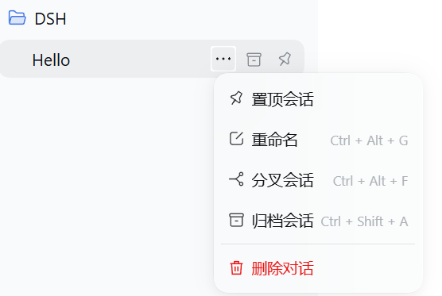
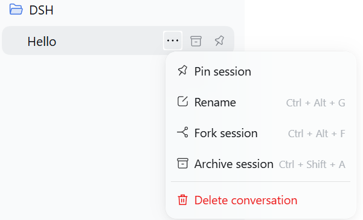
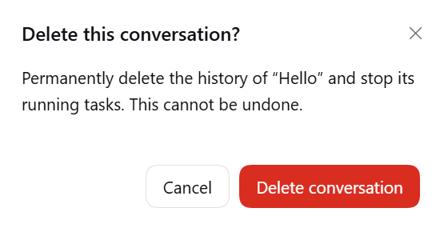

# dsh-desktop-delete

[English](README.md)

DeepSeek Harness 桌面端删除插件，版本 **0.1.3**。兼容范围：`0.2.0-rc.2 || >=0.2.1-rc.2 <0.3.0-0`，包含范围内的预发布版本。

在对话的三点菜单中，“归档会话”下方增加红色 **删除对话**。点击后显示原生确认框；取消不会修改会话，确认后停止目标对话的活动并删除其 JSONL 历史记录，移除工作区、置顶和归档记录，以及当前进程内的 Session/Agent。

## 效果图

| 中文菜单 | 中文确认框 |
| --- | --- |
|  |  |

| English menu | English confirmation |
| --- | --- |
|  |  |

## 安装

1. 从 [Releases](https://github.com/martin2026US-lab/dsh-desktop-delete/releases/latest) 下载 **dsh-desktop-delete-0.1.3-windows.zip** 并解压。
2. 从系统托盘菜单完全退出 DeepSeek Harness。仅关闭窗口不会退出后台进程。
3. 保持 ZIP 内的三个文件在同一目录：`Install.ps1`、`package.json` 和 `dsh-desktop-delete-0.1.3.tgz`。
4. 使用 PowerShell 7 执行：

```powershell
& 'C:\Program Files\PowerShell\7\pwsh.exe' -NoLogo -NoProfile -File '<解压目录>\Install.ps1'
```

自定义安装位置时添加 `-ApplicationPath '<路径>\DeepSeek Harness.exe'`。只检查兼容性、不安装时添加 `-CheckOnly`。

5. 重新打开桌面端。对话三点菜单末尾应显示“删除对话”。

脚本使用桌面端自带的 CLI 和包管理器，不要求系统安装 Node.js、npm 或 pnpm。它不会强制关闭应用，不修改签名的安装程序或 `app.asar`。

也可以按官方方式，使用**桌面端自带**的 `dsh` 命令安装：

```powershell
dsh plugin --profile desktop add '<完整路径>\dsh-desktop-delete-0.1.3.tgz'
```

卸载前同样完全退出桌面端，然后运行：

```powershell
dsh plugin --profile desktop remove dsh-desktop-delete
```

桌面 profile 由 Electron 管理；普通 npm 安装的 dsh 不能代替桌面端的命令。

## 实现与兼容性

- 使用原生 `sidebar.workspaces.session.menu.item` 和 `shell.overlay` 插槽，按真实 Session ID 操作，不依赖标题匹配或 DOM 注入。
- 删除 API 使用 Harness `connection.admit` 进行身份、Host 和 Origin 校验，并要求 POST、JSON 和明确确认。
- 先通过 `archiveSession(..., { stopActivity: true })` 阻止目标会话继续运行并请求停止对应活动。
- 只关闭目标 JSONL 写入句柄；冷会话也需通过后端独占写入锁检查。其他 Host 占用时拒绝删除。
- 0.1.1 修复旧格式删除：旧会话尚无 v4 文件时，通过后端提供的 JSONL locator 验证会话目录；随后由 Harness 在独占锁内完成格式迁移，再删除整个目录。无需先手动打开旧对话。
- 只删除持久化后端返回且规范化后位于 Harness 管理目录内的两层会话目录；使用原子重命名隔离后移除。
- 删除失败时尝试恢复数据目录、工作区归属、归档/置顶状态和目标写入句柄。被停止的运行任务不会自动重新执行。
- 退出维护操作后，仅释放目标 Agent 的 scope，再移除精确匹配的 Agent/Session 注册项，防止内存目录和搜索源让对话再次出现。
- 当前对话删除前先切换到空白对话；重复点击由服务端合并处理。

0.1.3 已通过 **0.2.1-rc.2、rc.3、rc.4、0.2.2-alpha.2** 的真实运行时测试。安装器直接读取包内 `engines.dsh`，使用桌面运行时自带的标准 semver 库判断，不再单独维护版本白名单。

### 后续版本兼容策略

- 声明有边界的 0.2.x 兼容范围，避免每个 rc 更新都因版本字符串不同而被拒绝。
- 删除前检查实际服务、生命周期和 writer 接口；接口缺失时，在停止任务或修改归档状态前拒绝执行。
- 新版优先使用官方 `stat().location` 存储位置字段，减少对私有 locator 的依赖；旧版保留经过路径检查的后备方案。
- GitHub Actions 每天新加坡时间 10:00 自动发现兼容范围内最新已发布运行时，并与四个基线版本一起在 Windows/Linux 测试。失败会显示在 Actions；不会自动修改本机插件或自动发布修复。
- `0.3.x` 及更高系列仍需重新评估。上游暂未提供公开的单会话删除接口，生命周期清理仍依赖经过检查的内部接口，因此无法承诺永久兼容。

删除是永久操作，确认框会提示无法撤销。该功能删除会话本身的历史记录，不删除工作区文件、其他会话或共享附件，也不承诺擦除通用缓存、备份或诊断日志中的副本。

## 验证

```powershell
npm ci --ignore-scripts
node --check lib/index.js
node --check lib/client.js
node --test test/*.test.js
```

详细结果见 [VALIDATION.md](VALIDATION.md)。Windows 下 **29 项独立测试**及四个官方运行时各 **8 项集成测试**全部通过，共 **61 次测试执行**。9 项 Windows 安装器测试在 Linux 上跳过。[运行时测试说明](test/integration/README.md) 介绍复现方法。效果图仍来自 0.1.1 / Harness 0.2.0-rc.2；新版桌面菜单操作尚未重新实测。

参考项目：[martin2026US-lab/dsh-session-organizer](https://github.com/martin2026US-lab/dsh-session-organizer)。删除的停止、flush、关闭 writer、隔离目录和失败恢复设计沿用该项目思路，桌面菜单与精确生命周期清理由此插件实现。

官方安装说明：[DeepSeek Harness Desktop — Bundled command runtime](https://github.com/deepseek-ai/deepseek-harness/blob/master/apps/desktop/README.md#bundled-command-runtime)。

## 授权

MIT；本插件属于非官方社区扩展。源代码不包含用户名、盘符或固定会话数据目录。
